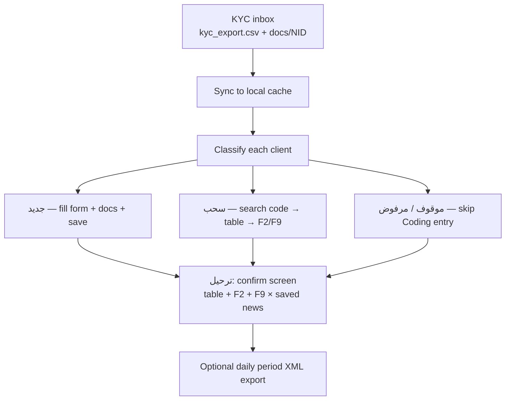
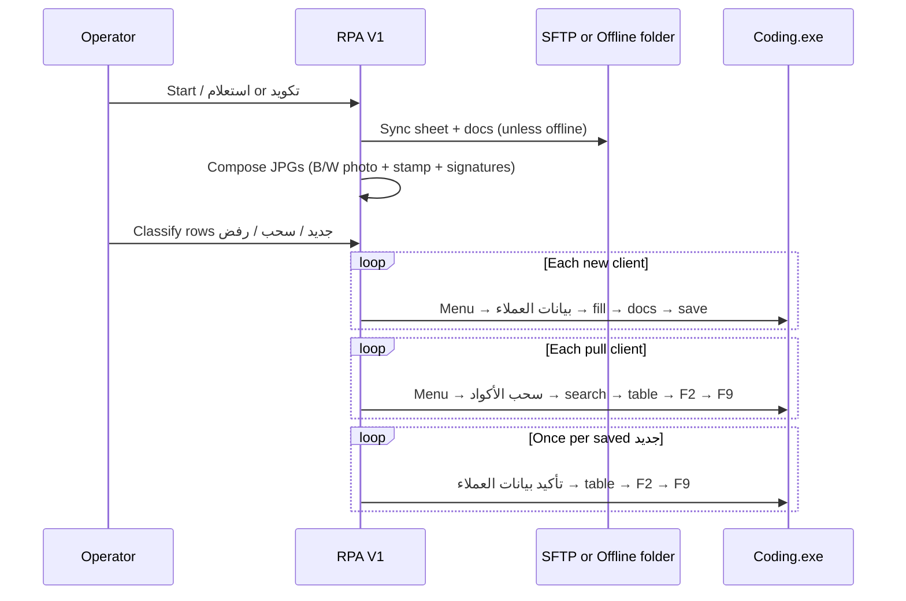
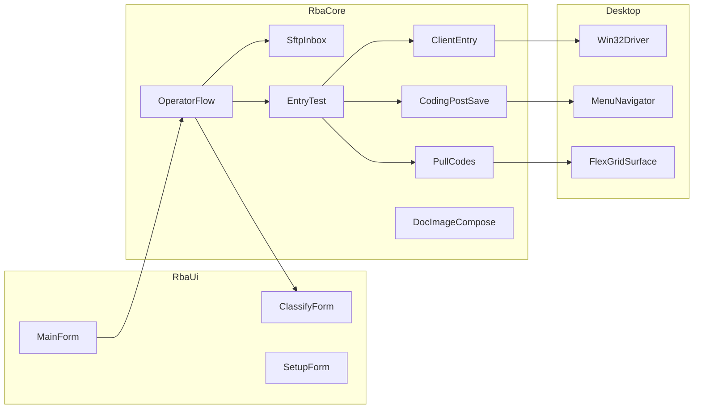
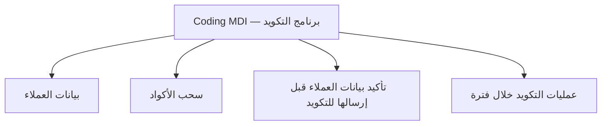

# EGX Client Coding RPA (RPA V1)

WinForms robot that takes KYC clients from an **SFTP inbox** (or a local offline folder), lets an operator **classify** each row, then drives the desktop **Coding** application (VB6) to add new clients, pull existing codes, attach documents, and **ترحيل (confirm)** saved news.

This README is the onboarding guide for **operations** and **engineers**. The shipped app UI is Arabic; domain words below stay in Arabic on purpose.

---

## What problem this solves

EGX client coding is still done in a legacy desktop app (`Coding.exe`). Staff used to:

1. Receive KYC files (sheet + ID photos).
2. Decide: new client, already coded (سحب), suspended, or reject.
3. Type the form by hand, attach scans, save, then confirm/ترحيل.

RPA V1 does the typing, document attach, pull-codes shortcuts, and confirm keys. **The operator still decides** جديد / سحب / مرفوض and enters the unified code for سحب. There is **no OCR / inquiry path** in the live operator flow.

---

## Business flow



### Operator decisions

| Decision | Arabic | What the robot does |
|---|---|---|
| New | جديد | Opens إدخال بيانات العملاء, fills fields, attaches JPG docs, saves |
| Pull | سحب | Opens سحب الأكواد, types CODE12, search → click table → F2 → F9 |
| Suspended | موقوف | Skips entry (can also be a **reject reason**) |
| Rejected | مرفوض | Writes status + reject reason; does not add the client |

ترحيل (confirm) runs **only if at least one جديد save succeeded**. F2/F9 is repeated **once per newly saved client**.

### Reject reasons (classify screen)

1. صورة بطاقة أوضح مطلوبة — Clearer ID  
2. كود مشابه/مكرر — Similar Code  
3. مستند ناقص مطلوب — Required Document  
4. نفس الكود باسم مختلف — Same Code Different Name  
5. مطلوب بطاقة الأب — Father ID  
6. مطلوب بيان/إقرار بالكود — Code Statement  
7. الاسم الخامس ناقص — Fifth Name  
8. بطاقة منتهية — Expired ID  
9. كود أوفلاين — Offline Code  
10. موقوف — Suspended  
11. أسباب أخرى — Others (**operator must type the text**)

Stored example for others: `أسباب أخرى: ختم غير واضح`.

---

## A real operator session



**Start modes**

- **استعلام** — walk the sheet and classify only (no Coding).  
- **تكويد** — run Coding against already classified rows.

---

## Technical architecture



| Area | Path | Role |
|---|---|---|
| Product UI | `RBA-CSharp/Ui/` | Dashboard, classify, setup, settings lock |
| Robot core | `RBA-CSharp/Core/` | Sync, fill, pull, confirm, sheets, SFTP |
| Lab Coding fake | `RBA-CSharp/CodingReplica/` | Win32-like menus to map without real Coding |
| Ship folder | `RPA-V1-Setup/` | Built `RPA-V1.exe` + Sample / OfflineInbox |
| Config template | `RBA-CSharp/release/bot-config.template.json` | Defaults for Coding titles + SFTP |
| Legacy VB6 dump | `Coding-Code-Project/` | Reference only — not the robot |

Runtime workspace (per machine): `%LocalAppData%\RPA-V1\`  
(`config\bot-config.json`, `config\settings.json`, `config\selectors.csv`, `SftpCache\`, `state\tracking.csv`).

Logs sit **beside the EXE** (`RPA-V1-Setup\logs\`), not only in AppData.

---

## Inbox layout (SFTP or offline)

Remote/local inbox expected shape:

```
inbox/
  kyc_export.csv
  docs/
    {14-digit NID}/
      01.jpg
      02.jpg
```

- **Online SFTP:** host/user/password in Settings. Inbox folder name is configurable (template default `kyc-imports`).  
- **Offline:** checkbox **وضع Offline** — read `SftpLocalRoot\inbox` (or last `SftpCache`) and never call `sftp.exe`.  
- After pull, images are copied to cache, converted to JPG, resized, put on a **white canvas**, ID photo + stamp + both signatures converted to **black and white**.

**Ping ≠ SFTP.** ICMP can work while OpenSSH still closes (KEX/auth). Use **فحص المصدر** and read the run log for the file listing.

---

## First-time technical setup

1. Windows + .NET Framework 4.x (`csc` from `Microsoft.NET\Framework64\v4.0.30319`).  
2. OpenSSH Client if you use real SFTP (`sftp.exe`).  
3. Build:

```bat
cd RBA-CSharp
build-rpa-v1.cmd
```

Output: `RPA-V1-Setup\RPA-V1.exe`.

4. Optional lab: `release\Setup-LocalSftpLab.ps1` seeds `C:\RPA-SFTP\inbox` and can force `sftpHost=local`.  
5. Start **Coding.exe** (or `CodingReplica.exe` for mapping).  
6. Start `RPA-V1.exe`. Unlock **إعدادات** with the admin lock (do not put that secret in git).  
7. **فتح الإعداد…**  
   - Point to Coding EXE + window title pattern (`برنامج التكويد`).  
   - **اتصال تلقائي**.  
   - Capture menus (إدخال / سحب / تأكيد / فترة).  
   - Capture fields (skip retired lookup keys).  
   - Save window sizes.  
   - Save settings + field map (`selectors.csv`).

Without a good map, fill will miss controls and waste time on retries.

---

## Settings operators actually change

| Setting | Meaning |
|---|---|
| Host / User / Password / Inbox | Real SFTP |
| Offline | Local files only |
| Stamp + two signatures | Overlays composed onto every KYC image |
| Image width | Resize after sync (default 1100) |
| **Fill pace (ms)** | Speed vs stability — defaults stay safe for VB6 |

Fill-pace defaults (do not lower blindly):

| Field | Default |
|---|---|
| Between fields | 700 |
| Settle | 550 |
| Between clients | 1100 |
| After save | 1300 |

Safer first experiment: 300 / 250 / 600 / 800. If combos or dates skip, raise again.

---

## Coding screens the robot touches



- **Entry:** field map + document picker (JPG).  
- **Pull:** search box, search button, grid — **not** a “سحب cell”. Sequence is search → table click → F2 → F9.  
- **Confirm:** grid click + F2 + F9, repeated for `newSavedCount`.  
- **Period export:** dates + Export + XML path (daily schedule, not after every save).

RPA **must not attach to itself**. Titles like `RPA V1` / `روبوت تكويد` are skipped.

---

## Repo map for new engineers

```
EGX_Coding_Automation/
  README.md                 ← you are here
  RBA-CSharp/
    Core/                   robot logic
    Ui/                     WinForms
    CodingReplica/          fake Coding
    release/                templates + lab scripts
    build-rpa-v1.cmd        ship EXE
  RPA-V1-Setup/             built payload
  Coding-Code-Project/      VB6/twinBASIC dump of real Coding (reference)
```

Important core types:

- `OperatorFlow` — sync → classify → execute  
- `SftpInbox` — local mirror / sftp-cli / probe / push sheet back  
- `EntryTest` — per-row جديد / سحب / skip + post-save confirm  
- `ClientEntry` — fill + save  
- `PullCodes` — pull screen  
- `CodingPostSave` — ترحيل + period export  
- `OperatorDecision` — statuses + reject list  
- `ActionPace` — timings applied from `settings.json`

---

## Safety and hygiene

- Do not commit live `kyc_export.csv` with real national IDs.  
- Do not commit admin lock secrets or real SFTP passwords in docs.  
- Operator path must not rewrite the sheet to `Sample\Test-Save-Client.csv`.  
- Detailed action log is for diagnosis; turn it down when stable.  
- Inquiry/OCR helpers may still exist in code; **production classify is manual**.

---

## Typical first week

1. Read this file and click through MainForm tabs (تشغيل / تتبع / إعدادات).  
2. Map CodingReplica, then real Coding, save selectors.  
3. Run Offline with 1–2 lab rows: one جديد, one سحب.  
4. Confirm F2/F9 count matches saved news.  
5. Only then enable remote SFTP and فحص المصدر.  
6. Tune fill pace after a clean mapped run.

Questions to ask the floor team: inbox folder name, stamp/signature files, whether Coding titles match the template, and what “أسباب أخرى” examples they type.
